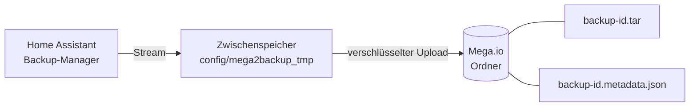

<div align="center">

# Mega Backup für Home Assistant

**Nutze dein [Mega.io](https://mega.io)-Konto als Speicherort für Home-Assistant-Backups.**

[](#installation)
[](https://github.com/Schnax3/mega2backup/releases)
[](https://github.com/Schnax3/mega2backup/actions/workflows/validate.yml)
[](https://github.com/Schnax3/mega2backup/actions/workflows/lint.yml)
[](LICENSE)

[](https://my.home-assistant.io/redirect/config_flow_start/?domain=mega2backup)

</div>

> **Status: frühe Version (0.1).** Die Integration funktioniert, ist aber noch jung. Prüfe nach der Einrichtung einmal, ob sich ein Backup hochladen und wieder herunterladen lässt, bevor du dich darauf verlässt.

---

## Inhalt

- [Was ist das?](#was-ist-das)
- [Funktionen](#funktionen)
- [Voraussetzungen](#voraussetzungen)
- [Installation](#installation)
- [Einrichtung](#einrichtung)
- [Backups nutzen](#backups-nutzen)
- [So funktioniert es](#so-funktioniert-es)
- [Einschränkungen](#einschränkungen)
- [Sicherheit und Datenschutz](#sicherheit-und-datenschutz)
- [Fehlersuche](#fehlersuche)
- [Log-Ausgabe](#log-ausgabe)
- [Häufige Fragen](#häufige-fragen)
- [Entwicklung und Mitmachen](#entwicklung-und-mitmachen)
- [English summary](#english-summary)

## Was ist das?

Home Assistant kann Backups an mehrere Orte schicken, zum Beispiel lokal, in die Home Assistant Cloud oder zu Google Drive. Diese Integration fügt **Mega.io** als weiteren Speicherort hinzu. Sie registriert einen *Backup-Agent*, der in den normalen Backup-Einstellungen auftaucht. Du brauchst keine Automatisierung und kein Add-on.

## Funktionen

| | |
| --- | --- |
| ☁️ **Upload** | Automatische und manuelle Backups gehen nach Mega, mit Fortschrittsanzeige in Home Assistant |
| 📥 **Download und Wiederherstellung** | Backups aus Mega lassen sich herunterladen und wiederherstellen |
| 🗑️ **Löschen** | Gelöschte Backups werden **endgültig** entfernt und belegen keinen Platz im Mega-Papierkorb |
| 🔁 **Aufbewahrung** | Die Backup-Aufbewahrung von Home Assistant (Anzahl der Backups) greift auch für Mega |
| 👥 **Mehrere Konten** | Du kannst mehrere Mega-Konten parallel einrichten |
| 🔑 **Neu anmelden** | Ändert sich dein Passwort, fragt Home Assistant danach, ohne die Einrichtung zu verlieren |
| 🧩 **Vollständige Backups** | Die Metadaten werden zuletzt hochgeladen, abgebrochene Uploads tauchen nicht als kaputte Backups auf |
| 🌍 **Sprachen** | Deutsch und Englisch |

## Voraussetzungen

- Home Assistant **2025.6** oder neuer
- Ein Mega-Konto **ohne Zwei-Faktor-Authentifizierung** (siehe [Einschränkungen](#einschränkungen))
- Freier Platz auf der Datenpartition von Home Assistant: so viel wie dein größtes Backup, denn es wird kurz zwischengespeichert
- Den **Marketplace** in Home Assistant (ab 2026.11, vorher HACS), oder du kopierst die Dateien von Hand

## Installation

### Über den Marketplace (Home Assistant 2026.11 oder neuer, empfohlen)

Seit Home Assistant 2026.11 ist HACS fest eingebaut und heißt **Marketplace**. Du findest ihn unter *Einstellungen → Marketplace*. Mega Backup ist ein Community-Projekt, das nicht im Katalog steht, du fügst es deshalb über seinen Link hinzu:

1. Öffne **Einstellungen → Marketplace**.
2. Klicke oben rechts auf **Über Link hinzufügen**.
3. Trage `https://github.com/Schnax3/mega2backup` (oder `Schnax3/mega2backup`) ein und klicke auf **Hinzufügen**. Falls der Typ nicht erkannt wird, wähle *Integration* und klicke erneut auf **Hinzufügen**.
4. Installiere **Mega Backup** wie jedes andere Projekt.
5. Wenn der Marketplace einen Neustart verlangt, nutze die Reparatur unter *Einstellungen → System → Reparaturen*. Danach kannst du die Integration hinzufügen (siehe [Einrichtung](#einrichtung)).

### Über HACS (Home Assistant 2026.10 und älter)

1. Öffne HACS → ⋮ → *Benutzerdefinierte Repositories*, trage `https://github.com/Schnax3/mega2backup` ein und wähle die Kategorie *Integration*.
2. Lade **Mega Backup** herunter und starte Home Assistant neu.

### Manuell

1. Lade das Repo herunter und kopiere den Ordner `custom_components/mega2backup` nach `<config>/custom_components/mega2backup`.
2. Starte Home Assistant neu.

## Einrichtung

1. Öffne **Einstellungen → Geräte & Dienste → Integration hinzufügen** und suche nach **Mega Backup**. Oder klicke oben auf *Integration hinzufügen*.
2. Fülle das Formular aus:

   | Feld | Bedeutung |
   | --- | --- |
   | Mega-E-Mail-Adresse | E-Mail-Adresse deines Mega-Kontos |
   | Passwort | Passwort deines Mega-Kontos |
   | Backup-Ordner | Name des Ordners für die Backups. Standard: `Home Assistant Backups`. Er wird im Hauptverzeichnis deines Cloud-Speichers angelegt, falls er noch nicht existiert. Nur eine Ebene, keine Schrägstriche, keines der Zeichen `" * / : < > ? \ \|` |

3. Fertig. Der Speicherort ist jetzt in Home Assistant verfügbar.

> **Tipp:** Lege ein eigenes Mega-Konto nur für Backups an. Das Passwort liegt in der Home-Assistant-Konfiguration (siehe [Sicherheit](#sicherheit-und-datenschutz)), und du hast so deinen normalen Speicher sauber getrennt.

## Backups nutzen

1. Öffne **Einstellungen → System → Backups**.
2. Unter **Automatische Backups** (Zahnrad oben rechts) den Speicherort **Mega Backup** aktivieren. Dort legst du auch Zeitplan und Anzahl der aufbewahrten Backups fest.
3. Für ein einzelnes Backup: **Backup jetzt erstellen**, dann den Speicherort auswählen.
4. Wiederherstellen oder herunterladen: Backup in der Liste öffnen. Zeigt es Mega als Speicherort, kannst du es von dort laden.

Das Backup ist erst fertig, wenn Home Assistant den Upload als erfolgreich meldet. Bei großen Backups dauert das eine Weile.

## So funktioniert es

Ein Backup wird in zwei Schritten zu Mega geschickt:



Im Backup-Ordner liegen pro Backup zwei Dateien:

| Datei | Inhalt |
| --- | --- |
| `<id>.tar` | das eigentliche Backup |
| `<id>.metadata.json` | Name, Datum, Größe und enthaltene Komponenten |

- **Zwischenspeicher:** Die verwendete Bibliothek arbeitet mit Dateien. Deshalb landet ein Backup beim Hoch- und Herunterladen kurz in `<config>/mega2backup_tmp`. Der Ordner liegt bewusst auf der Datenpartition und nicht in `/tmp`, weil `/tmp` auf Home Assistant OS im Arbeitsspeicher liegt. Die Integration prüft vorher, ob genug Platz frei ist, und räumt Reste beim Start auf.
- **Arbeitsspeicher:** Die Daten werden in kleinen Stücken (1 MB) verarbeitet. Auch große Backups brauchen daher wenig RAM.
- **Liste:** Die Dateiliste wird bis zu 5 Minuten zwischengespeichert, nach Upload und Löschen sofort verworfen.

## Einschränkungen

- **Keine Zwei-Faktor-Authentifizierung.** Die Bibliothek kann sie noch nicht. Ist sie im Konto aktiv, schlägt die Einrichtung mit einem passenden Hinweis fehl.
- **Keine Unterordner.** Der Backup-Ordner liegt direkt im Hauptverzeichnis.
- **Inoffizielle Anbindung.** Mega bietet keine offizielle Python-Schnittstelle. Die Integration nutzt [`async-mega-py`](https://pypi.org/project/async-mega-py/). Ändert Mega seine Schnittstelle, kann die Integration vorübergehend ausfallen, bis die Bibliothek nachzieht.
- **Mega-Speicherplatz.** Reicht dein Kontingent nicht, schlägt der Upload mit einer Fehlermeldung von Mega fehl. Die Integration prüft den freien Mega-Speicher nicht vorher.
- **Dauer.** Großes Backup und kleines System (zum Beispiel Raspberry Pi mit SD-Karte) bedeuten lange Uploads, denn die Verschlüsselung läuft auf der CPU.

## Sicherheit und Datenschutz

- Mega verschlüsselt Dateien Ende-zu-Ende. Die Bibliothek erledigt das lokal, bevor Daten dein System verlassen.
- Aktiviere **zusätzlich die Backup-Verschlüsselung von Home Assistant**. Dann ist das Backup auch geschützt, wenn du die Datei aus Mega herunterlädst, und der Verschlüsselungsschlüssel bleibt bei dir.
- Dein Mega-Passwort speichert Home Assistant wie bei allen Integrationen unverschlüsselt in `.storage/core.config_entries`. Nutze deshalb ein eigenes Konto und ein eigenes Passwort nur für Backups, und gib `.storage` nicht weiter.
- Die Integration kontaktiert nur Mega. Es gibt keine weitere Telemetrie.

## Fehlersuche

Debug-Logging einschalten, in `configuration.yaml`:

```yaml
logger:
  logs:
    custom_components.mega2backup: debug
    mega: debug
```

| Problem | Ursache und Lösung |
| --- | --- |
| „Ungültige E-Mail-Adresse oder ungültiges Passwort" | Zugangsdaten falsch oder das Konto ist gesperrt. Probiere die Anmeldung auf mega.io. |
| „Zwei-Faktor-Authentifizierung wird nicht unterstützt" | 2FA im Mega-Konto ausschalten oder ein separates Konto ohne 2FA nutzen. |
| „Verbindung zu Mega fehlgeschlagen" | Mega nicht erreichbar oder Netzwerkproblem. Später erneut versuchen. |
| „Not enough free disk space to stage the backup" | Auf der Datenpartition ist zu wenig Platz. Alte Backups oder Daten löschen. |
| Backup bricht ab, Home Assistant startet neu | Meist Speichermangel. Prüfe freien Plattenplatz und RAM, siehe Log. |
| Upload wirkt hängend | Große Backups brauchen Zeit. Beobachte den Fortschritt in der Backup-Ansicht und das Debug-Log. |
| Anmeldung nach Passwortänderung | Home Assistant zeigt „Neu authentifizieren" bei der Integration an. Neues Passwort eingeben. |

Beim Melden eines Fehlers bitte das Debug-Log anhängen. **Entferne vorher E-Mail-Adresse und andere private Daten.**

## Log-Ausgabe

Wie viel die Integration ins Home-Assistant-Log (*Einstellungen → System → Protokolle*) schreibt, hängt von der Version ab:

| Release-Art | Version in `manifest.json` | Log-Ausgabe |
| --- | --- | --- |
| **Vollständiges Release** | zum Beispiel `0.2.0` | nur **Fehler** (`ERROR`) |
| **Vorabversion (Pre-release)** | zum Beispiel `0.2.0b1`, `0.2.0-beta.1` oder `0.2.0-rc.1` | **alles**, auch Debug-Meldungen (Upload-Fortschritt, Mega-Bibliothek und mehr) |

Das gilt für `custom_components.mega2backup` und für die Mega-Bibliothek `mega`. Ein Pre-release erkennt die Integration an der Version in der `manifest.json`, nicht am GitHub-Häkchen. Setze deshalb für ein Pre-release **beides**: eine Vorabversion in der `manifest.json` und das Häkchen *Set as a pre-release* beim Veröffentlichen. Der Workflow „Release check" meldet einen Fehler, wenn Tag, Version und Häkchen nicht zusammenpassen.

Eigene Einstellungen haben immer Vorrang. Willst du in einem normalen Release trotzdem mehr sehen, trage das in `configuration.yaml` ein:

```yaml
logger:
  logs:
    custom_components.mega2backup: debug
    mega: debug
```

## Häufige Fragen

**Brauche ich Mega Pro?** Nein, auch das kostenlose Konto funktioniert, solange der Speicher für deine Backups reicht.

**Kann ich ein Backup direkt in Mega ansehen?** Du siehst im Mega-Konto die Dateien `<id>.tar` und `<id>.metadata.json`. Die `.tar`-Datei ist ein normales Home-Assistant-Backup, das du auch manuell importieren kannst.

**Werden Backups ersetzt, wenn die ID schon existiert?** Ja, ein vorhandenes Backup mit derselben ID wird vor dem Upload entfernt.

**Wo ist der Papierkorb?** Gelöschte Backups werden endgültig gelöscht und landen nicht im Mega-Papierkorb.

**Darf ich den Ordner in Mega umbenennen oder Dateien verschieben?** Besser nicht. Die Integration findet Backups über Ordnername und Dateiname.

## Entwicklung und Mitmachen

Das Repo prüft sich selbst per GitHub Actions: **Hassfest**, **HACS-Validierung**, **Ruff** und **CodeQL**. Dazu kommen **Dependabot** für Abhängigkeiten, **Release Drafter** für Release-Notizen und ein **Stale-Bot** für alte Issues.

Fehler und Ideen bitte als [Issue](https://github.com/Schnax3/mega2backup/issues) melden. Pull Requests sind willkommen, bitte vorher `ruff check` und `ruff format` ausführen.

Der Marketplace und HACS lesen die Datei `hacs.json` im Hauptverzeichnis und die Prüfungen im Repo heißen deshalb weiterhin „HACS". Ein Release entsteht so: `version` in `custom_components/mega2backup/manifest.json` erhöhen, auf `main` pushen und den Release-Drafter-Entwurf unter *Releases* mit passendem Tag (`v<version>`) veröffentlichen. Für ein Pre-release eine Vorabversion wie `0.2.0b1` verwenden und das Häkchen *Set as a pre-release* setzen (siehe [Log-Ausgabe](#log-ausgabe)).

## English summary

**Mega Backup** adds [Mega.io](https://mega.io) as a backup location for Home Assistant. It registers a backup agent, so Mega shows up next to the other locations in *Settings → System → Backups*. Install it through the Marketplace (*Settings → Marketplace → Add from link*, `Schnax3/mega2backup`; on Home Assistant 2026.10 and older use HACS with a custom repository), restart if asked, then add the **Mega Backup** integration with your Mega e-mail, password and a folder name.

Backups are stored as `<id>.tar` plus `<id>.metadata.json` in one folder at the root of your drive. Deleting a backup removes it permanently. Not supported yet: two-factor authentication. Large backups are staged briefly in `<config>/mega2backup_tmp` (needs free disk space of about one backup). Requires Home Assistant 2025.6 or newer.

## Lizenz

[MIT](LICENSE). Dieses Projekt steht in keiner Verbindung zu Mega Limited.
